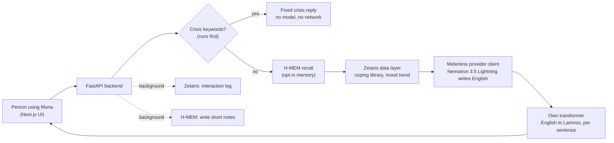

# Muna: a gentle space to talk, in English and Lamnso

Muna is a mental-wellbeing companion for people who speak **Lamnso**, a language of Cameroon with almost no
digital mental-health support. A modern LLM writes a kind, short reply in English; the project's **own
English to Lamnso transformer** (trained before this hackathon) translates it sentence by sentence, and shows
the English underneath so nobody is left with a bad translation.

> **Muna is not therapy and not a substitute for professional care.** In an emergency contact your local
> emergency services. See [Safety and privacy](#safety-and-privacy) for exactly what the app does and does not do.

Built for the **Open Agent Hackathon 2026** with **Zetaris** (data layer), **Meterless** (H-MEM engine and
provider contract) and **NVIDIA Nemotron** (the model that writes the replies).

## How it works



| Step | What happens | Where |
|---|---|---|
| 1. Safety first | A keyword net checks the raw text (English and Lamnso) before anything else. A hit returns fixed, pre-written text. No model is called. | `translation/crisis_safety.py`, `backend/app/safety.py` |
| 2. Language gate | The translator only goes English to Lamnso, so Lamnso input gets an honest "please write in English for now". | `backend/app/pipeline.py` |
| 3. Memory (opt-in) | If the person switched memory on, H-MEM recalls short notes from earlier visits. | `engines/hmem/`, `backend/app/hmem_client.py` |
| 4. Data layer | Zetaris supplies vetted coping ideas (the model may offer nothing else) and, with consent, a weekly mood trend. | `backend/app/store.py` |
| 5. Reply | Nemotron writes 2 or 3 very short sentences through a Meterless-style provider client. The model that answered is recorded. | `backend/app/nightshift.py` |
| 6. Translate | Each sentence is translated alone. Empty or looping output is caught, one simpler retry is made, and Lamnso is shown only if every sentence is usable. | `translation/translator.py` |
| 7. Learn and log (background) | Zetaris logs route, model and latency. If memory is on, the model writes up to two anonymous, paraphrased notes. | `backend/app/learning.py` |

## Quick start (about two minutes, no keys)

`SAMPLE_MODE=true` runs everything offline with clearly labelled stand-ins: a canned reply, a placeholder
translation (prefixed `[sample-lamnso]`), no Zetaris. Use it to look around.

```bash
git clone https://github.com/Fai-jr/lamnso-care-agent.git && cd lamnso-care-agent
python3 -m venv .venv && source .venv/bin/activate
pip install -r requirements-sample.txt
cp .env.example .env                 # SAMPLE_MODE=true is the default
WITH_UI=1 bash scripts/run_dev.sh    # memory service + backend + UI
```

Open **http://localhost:3001**. Needs Python 3.10+ and Node 18+ (the script installs the Node dependencies on first run).
Backend API docs: http://127.0.0.1:8000/docs.

## Full setup (real model, real translator, Zetaris)

1. **Install everything**
   ```bash
   pip install -r requirements.txt     # large: torch. CPU only is enough:
   # pip install torch --index-url https://download.pytorch.org/whl/cpu
   ```
   Java 8 or newer is needed for the Zetaris driver.
2. **Model provider.** Create a free key at build.nvidia.com (Nemotron 3.5 Lightning) and put it in `.env`:
   ```
   METERLESS_BASE_URL=https://integrate.api.nvidia.com/v1
   METERLESS_RUNTIME_TOKEN=<your key>
   METERLESS_MODEL=nvidia/nemotron-3.5-lightning-30b-a3b
   METERLESS_EXTRA_BODY={"chat_template_kwargs":{"enable_thinking":false}}
   ```
   With a Meterless Runtime (Nightshift) these become `http://127.0.0.1:8088/v1`, the runtime token and `meterless/auto`;
   no code changes. Check the connection: `python scripts/check_nightshift.py`.
3. **Translator weights** (32 MB, checksum-verified): `python -m translation.download_weights`
4. **Zetaris.** Start the Zetaris hackathon stack (its own guide), then set `ZETARIS_JAR_PATH`, `ZETARIS_USER`,
   `ZETARIS_PASSWORD` in `.env` and run:
   ```bash
   python scripts/check_zetaris.py                 # SELECT 1
   python scripts/setup_zetaris.py --selftest      # datalake, 3 tables, 6 seed rows; safe to repeat
   ```
5. **Switch the real services on and run:** set `SAMPLE_MODE=false` in `.env`, then `WITH_UI=1 bash scripts/run_dev.sh`.

The UI is at http://localhost:3001 (Zetaris itself uses port 3000). `GET /health` shows what is connected.

## Using it

| Do this | You get |
|---|---|
| Tap a suggestion, or type "I feel anxious at night" and press Enter | A short reply, Lamnso with English underneath, and "Answered by <model>" |
| Settings (gear), then **Remember what helps me** | Opt-in memory between visits (off by default) |
| Settings, then **What do you remember?** | Every stored note, in plain words |
| Settings, then **Forget me** | Erases notes and mood check-ins |
| Open the app in a new tab | A 4-second **Muna splash** (logo, tagline); tap, Enter or Escape skips it. Once per browser session. |
| Tap 1 to 5 under "How are you feeling right now?" | A mood check-in stored in Zetaris under an anonymous key |
| `curl localhost:8000/stats` | Requests per route and model, read live from Zetaris |

### API

`POST /chat` `{message, session_id, user_id?, remember?}` · `POST /checkin` · `POST /memory/export|forget|feedback` ·
`GET /stats` · `GET /health`. Interactive docs at `/docs`.

## Sample inputs and outputs

Real runs against `nvidia/nemotron-3.5-lightning-30b-a3b`. The Lamnso is machine output and has **not** been
verified by a fluent speaker (see [Known limitations](#known-limitations)).

| Input | English reply | Lamnso (machine translation) |
|---|---|---|
| I feel very tired and sad today | I am sorry you are feeling sad. It is okay to have hard days. | M dzə̀ʼə̀m, a m dzə̀ e wò wùn. Wìr lóo ker vifií, wù wàa ker vifií. |
| I cannot sleep at night | I am sorry you are having trouble sleeping. It can be frustrating when you cannot rest. | M sí sí ján, a m sí sí sə́n, a dzə̀ ŋgeʼ si. Wìr lóo ker vifií, bo wù kù yíi a dzə e tin, a bó yòʼ dzə̀ á kfə̀n sə̀ʼsí. |
| I feel alone | I hear you feeling alone. That sounds really hard. Do you want to talk more about it? | M yù ne kinyo ke m suuyì. Bó yòʼ dzə̀ sáʼka wo wù yú vijuŋ. À yii lóo suŋnín, à wàa suŋnín lám e wò? |
| *(a message about wanting to die)* | Fixed, pre-written support text (no model call, `route: "crisis"`) | Fixed Lamnso text, to be confirmed by a fluent speaker |

**Trace** (returned by `/chat`, shows how the agent reached its output and which model handled it):

```
['safety:no_crisis', 'zetaris:3 coping idea(s)',
 'nightshift:nvidia/nemotron-3.5-lightning-30b-a3b -> answered by nvidia/nemotron-3.5-lightning-30b-a3b',
 'translate:withheld (2/3 sentences usable)', 'retry:simplified -> translate:ok (2/2 sentences)']
```

**Memory across two sessions** (opt-in; notes are model-written paraphrases, never the person's words):

```
session 1  "I feel anxious at night and cannot sleep"   -> memories_used: []
session 2  "It is night again and I am anxious"          -> memories_used:
  mem-1  Experiences racing thoughts at night that interfere with rest        (score 0.226)
  mem-2  Finds it difficult to quiet the mind when trying to sleep             (score 0.166)
```

**`GET /stats`** (a live Zetaris query):

```json
{"total_requests":1,"by_route_and_model":[{"route":"agent","model_used":"nvidia/nemotron-3.5-lightning-30b-a3b","requests":1,"avg_latency_ms":1765,"translated":1}]}
```

## Tests and evidence

| Check | Command | Result |
|---|---|---|
| Backend (pipeline, safety, provider client, Zetaris layer, memory) | `python -m pytest -q` | 79 passed (75 passed, 2 skipped on a fresh clone until `npm --prefix engines/hmem install`) |
| H-MEM conformance, this repo's engine | `npm --prefix engines/hmem run conformance` | 13/13 |
| H-MEM conformance, **Meterless's unmodified runner** | see [`engines/hmem/README.md`](engines/hmem/README.md) | 13/13 |
| H-MEM engine tests (isolation, privacy, erase, HTTP) | `npm --prefix engines/hmem test` | 12 passed |
| UI behaviour (jsdom: splash, chat, memory, themes, voice, errors) | `cd frontend && npm i -D vitest@2 jsdom @testing-library/react @testing-library/user-event && npm test` | 24 passed |

Saved outputs are in [`docs/evidence/`](docs/evidence/).

## Dependencies

| | Needed for | Notes |
|---|---|---|
| Python 3.10+ | backend | `requirements-sample.txt` or `requirements.txt` |
| Node 18+ | H-MEM service, UI | installed automatically by `scripts/run_dev.sh` |
| Java 8+ | Zetaris JDBC driver | full mode only |
| **Zetaris** hackathon stack (Docker) | data layer | full mode only; port 3000 (UI), 10000 (JDBC) |
| **Meterless** H-MEM spec and Runtime provider contract | memory engine, provider client | engine vendored in `engines/hmem` (Apache-2.0) |
| NVIDIA API key | Nemotron replies | free at build.nvidia.com; never commit it |
| Model weights | translator | GitHub Release `v0.1-weights`, fetched by `translation.download_weights` |

Details of how each sponsor technology is used: **[`docs/SPONSOR_TECHNOLOGY.md`](docs/SPONSOR_TECHNOLOGY.md)**.

## Safety and privacy

- **Crisis path first and offline.** The keyword net runs before translation, memory, Zetaris or any model, and answers with fixed text.
- **No raw messages stored.** Memory holds short paraphrased notes only, only if the person turns it on, never from a crisis message. The service rejects notes that look like emails, links, phone numbers or instructions.
- **Real erasure.** "Forget me" deletes notes (also from the audit log and in-memory backups) and mood check-ins. If check-ins cannot be erased the app says so.
- **No message text in logs.** The trace log records route, model, latency and lengths. Content logging is off unless `LOG_CONTENT=true` (synthetic demo data only).
- **No user text in SQL.** Every value sent to Zetaris is a number, a hash or a fixed-list string.
- **Honest translation.** If any sentence cannot be translated reliably, no Lamnso is shown, only English.
- **Supportive text is vetted.** The model is told to offer coping ideas only from the Zetaris library; it is not allowed to diagnose or give medical advice.

## Known limitations

- **Input is English** (the translator only goes English to Lamnso). Lamnso crisis keywords are still detected.
- **Translation quality is modest.** The checkpoint reports `val_loss 2.90` and `BLEU 7.45`; it was trained on Bible and dictionary text. A fluent-speaker review sheet is generated by `scripts/export_translations_for_review.py`; see [`docs/SUBMISSION_CHECKLIST.md`](docs/SUBMISSION_CHECKLIST.md).
- **Crisis wording in Lamnso and the helplines list need human verification** before real-world use. Only entries marked `verified: true` in `sample_data/crisis_resources.json` are ever shown.
- **Meterless Nightshift has no Ubuntu x86 build** (DGX Spark, Mac and Windows only). The provider client implements the Meterless Runtime contract and was tested against NVIDIA's hosted API, as agreed with Meterless staff. See the sponsor document.
- Mood check-in and library content are generic wellbeing ideas, not clinical guidance.

## Repository map

```
backend/app/     FastAPI: pipeline, safety, provider client, H-MEM client, Zetaris store, learning
engines/hmem/    Meterless H-MEM: reference core + care-domain embedder, privacy layer, HTTP service, tests
translation/     English to Lamnso transformer (pre-existing), wrapper, weights downloader, crisis keywords
frontend/        Next.js UI to the Muna design spec (two colour variants, splash screen, logo)
scripts/         run_dev.sh, setup_zetaris.py, check_nightshift.py, check_zetaris.py, export_translations_for_review.py
sample_data/     crisis_resources.json (verified contacts only)
legacy/          pre-existing components, declared in PRE_EXISTING.md
docs/            sponsor explanation, demo script, deck outline, submission checklist, evidence
```

## Pre-existing components (declared)

The translation model and tokenizer, the crisis keyword net, the Next.js project scaffolding, and the open-source
H-MEM reference code were written before the hackathon or come from Meterless. Everything else (the FastAPI backend,
the Zetaris integration, the provider client, the memory service and privacy layer, the redesigned UI and the
tests) was built during the build window. Full list: [`legacy/PRE_EXISTING.md`](legacy/PRE_EXISTING.md).

## Licence

Apache-2.0 for `engines/hmem/src` and `engines/hmem/conformance` (Meterless). Project code: add your licence of choice.
